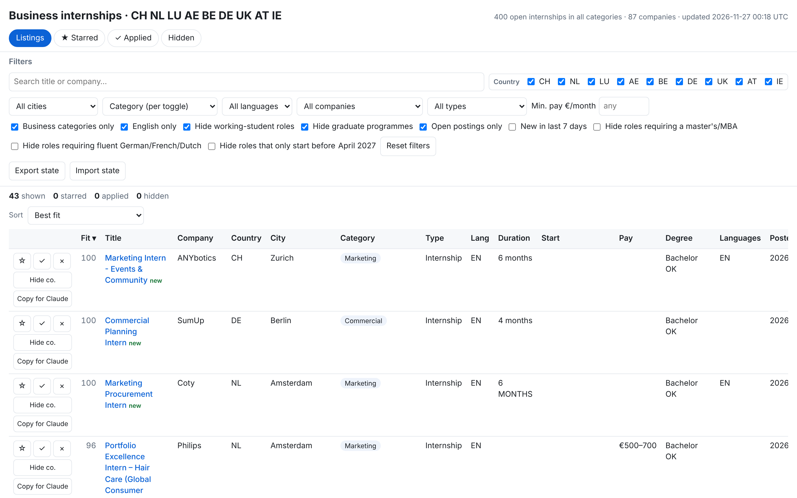
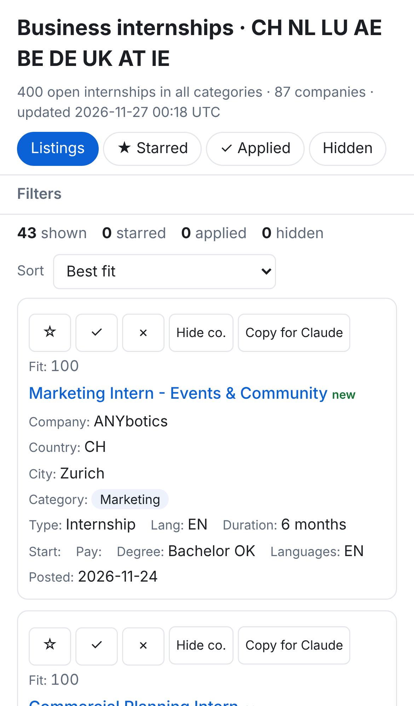
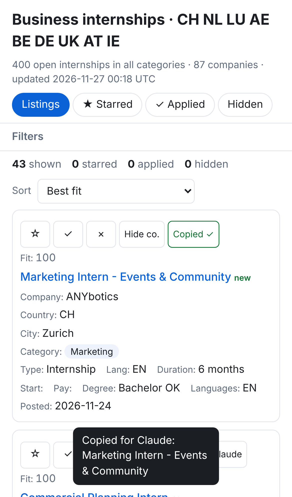
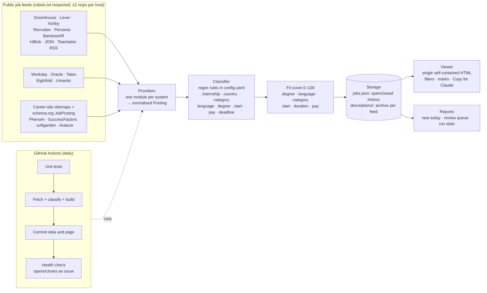

# AI Internship Finder

Built by **Mario Paraschiv** · [LinkedIn](https://www.linkedin.com/in/marioaparaschiv)

**A daily, rule-based scanner that reads 98,406 public job postings from 268 employers across 8 European countries and the UAE, and turns them into one filterable page of business internships.**

  

<p align="center">
  <br>
  
  
</p>

## What it does

Every morning a GitHub Actions job reads the public job feeds that employers' applicant tracking systems already
publish, keeps the internships in business roles (marketing, brand, sales, strategy, consulting, finance, …) in the
target countries, scores each one against a set of preferences, and publishes a single self-contained HTML page.

Numbers from the latest run (2026-11-27):

| | |
|---|---|
| Job postings screened per run | **98,406** |
| Employers covered | **268** feeds, verified live |
| Countries | **Switzerland, Netherlands, Luxembourg, UAE, Belgium, Germany, United Kingdom, Austria, Ireland** |
| Matching internships (open, all business categories) | **2,262** |
| Job descriptions archived | **1,966** |
| Runtime | 15–20 minutes, no paid services |

The viewer (one HTML file, works offline) lets you filter by country, city, category, language, degree level,
required languages, start date and pay; star, hide and mark postings as applied; and copy any posting with its
full description to paste into an AI assistant when tailoring a CV or preparing an interview.

> This repository contains a small recent sample of the data (`data/jobs.json`) and a viewer built from it
> (`docs/index.html`). All postings are public job ads.

## Architecture



## Job systems supported

| Kind | Systems |
|---|---|
| Public JSON/XML job APIs | Greenhouse, Lever, Ashby, Recruitee, Personio (XML), BambooHR, HiBob, JOIN, Workday, Oracle Recruiting Cloud, Taleo, Eightfold |
| Feeds | Teamtailor RSS, Workday's own job sitemap |
| HTML list pages | Abacus Umantis |
| Sitemap + schema.org `JobPosting` | Phenom, SAP SuccessFactors (RMK microdata), softgarden, Avature, and any careers site that publishes it |
| Checked and deliberately not used | iCIMS and Pinpoint (robots.txt disallows), SmartRecruiters (API disallowed for bots), Workable (rate-limited for automated clients), Cornerstone (needs a session token) |

Employers whose systems can't be read are documented with the reason in `gaps.yaml` / `gaps.md`
(315 employers), so coverage is explicit rather than silently incomplete.

## Engineering choices

- **Polite by design.** A shared HTTP client enforces robots.txt as RFC 9309 defines it (wildcards, longest match,
  "unreachable means disallow"), at most 2 requests per second per host, the site's `Crawl-delay`, a descriptive
  User-Agent, and per-run page budgets for large sitemap crawls. Detail pages are fetched only for
  internship-like titles. Systems that block automated access are recorded as gaps, never worked around.
- **Deterministic classification.** No LLM calls and no API keys at runtime: internship type, country (with
  look-alike guards such as Lake Zurich IL or Luxembourg province BE), category, language, degree level, required
  languages, start date, duration, pay (converted to EUR/month) and application deadline are all keyword/regex
  rules in `config.yaml`, in English, German, French, Dutch and Italian. Every rule change is covered by tests.
- **Data model.** Postings are keyed `provider:company:job_id`; a posting closes only after it is missing in two
  consecutive successful runs, and a failing feed keeps its last state instead of closing everything. Duplicate
  postings are merged. Descriptions are archived per feed outside the main JSON so diffs stay readable.
- **Health checks.** After each run, `finder health` compares the run with the previous one and the workflow opens
  (or comments on) a GitHub issue when a step failed, more than 10% of feeds failed, or matches dropped by more than
  40%; the issue closes itself after the next healthy run. A monthly job re-verifies every feed.
- **Tests.** 171 unit tests run before every daily fetch: classifier cases, country look-alikes, date/pay/deadline
  parsing, robots.txt semantics, the store's open/closed logic, the viewer build, and every provider against saved
  sample responses (fixtures), so a provider change can be tested offline.

## How it was built

Built with agentic AI coding (Claude Code), with me directing the AI through written specs, code reviews and
debugging: I defined what the tool must and must not do (public feeds only, robots.txt, no LLM calls at runtime),
reviewed each change, decided what to do about blocked or misclassified sources, and steered the debugging when
feeds broke (for example, when Workday started refusing automated clients in November 2026 and the tool moved those
employers to Workday's own sitemaps).

## Run it yourself

```bash
pip install -r requirements.txt
python -m unittest discover -s tests -t .   # offline tests
python -m finder run --only "Stripe"        # fetch one employer (~5 s)
python -m finder run                        # all employers (15–20 min)
open docs/index.html                        # the viewer, works offline
```

Add an employer with `python -m finder discover "Acme AG" https://acme.example/careers --add`; classification
rules and the fit-score weights are in `config.yaml`. The GitHub Actions workflows are included with their schedule
disabled; run them from the Actions tab, or restore the `schedule:` block to run daily. The full operator manual
is in [`docs/OPERATING.md`](docs/OPERATING.md).
